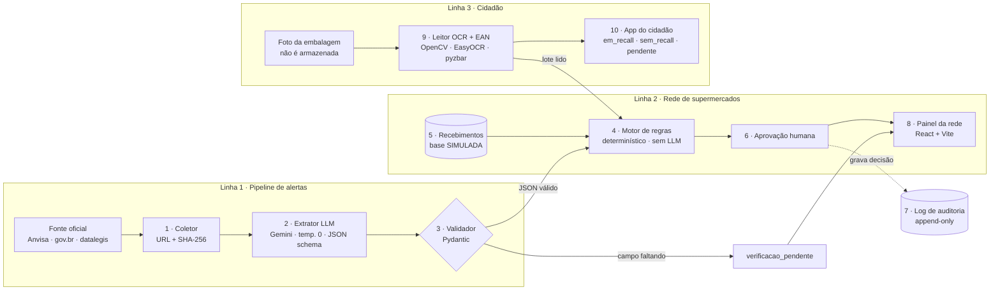

# Arquitetura, contratos de dados e regras do motor

Resumo técnico da solução **Recall Seguro**. A fonte de verdade do contrato é o documento do grupo *Arquitetura e papéis — Recall de alimentos* (raiz do repositório) e a versão **[v2]** acordada em 16/11/2026.

## 1. Visão geral

**Princípio central:** o LLM **só extrai**. Quem decide é o **motor de regras determinístico** e um **humano**.



Versão em imagem: [`img/diagramas/arquitetura.png`](img/diagramas/arquitetura.png).

## 2. Componentes e estado de implementação

| # | Componente | Tecnologia | Papel | Estado em 19/11/2026 |
|---|---|---|---|---|
| 1 | Coletor de alertas | requests, BeautifulSoup, pdfplumber | Tech Lead | 🟡 `baixar_textos.py` baixa os 20 textos oficiais da avaliação; coleta agendada não implementada |
| 2 | Extrator LLM | Gemini `gemini-3.5-flash-lite`, schema + few-shot, temp. 0 | IA | ✅ `src/ia/extrator.py` |
| 3 | Validador | Pydantic v2 | IA | ✅ `src/ia/schemas.py` |
| 4 | Motor de regras | Python puro | Full-Stack | ✅ `lista`, `sufixo`, `data_corte`, `todos` e escopo `categoria_fabricante` (fabricante + categoria) |
| 5 | Base de recebimentos | Faker + SQLite | Tech Lead | 🟡 recebimentos simulados nos testes; base SQLite não criada |
| 6 | Aprovação humana | FastAPI + painel | Full-Stack | ✅ `POST /matches/{id}/decisao` + botões no painel |
| 7 | Log de auditoria | SQLite append-only | Tech Lead | 🔴 não implementado (decisão fica gravada no próprio match) |
| 8 | Painel da rede | React + Vite | Full-Stack | ✅ `src/painel` |
| 9 | Leitor da embalagem | OpenCV + EasyOCR + pyzbar | IA | ✅ `src/ia/embalagem.py` |
| 10 | App do cidadão | React + Vite | Full-Stack | 🟡 endpoint `POST /cidadao/verificar` validado de ponta a ponta (`tests/test_cidadao_verificar.py`); a pasta `app-cidadao` ainda replica o painel |

## 3. Contratos de dados (resumo)

### Formato 1 — Alerta extraído (Extrator → Validador → Motor)

```json
{
  "alerta_id": "vaidosa",
  "fonte_url": "https://www.gov.br/anvisa/...",
  "fonte_hash": "sha256:...",
  "produto": "Ricota Fresca",
  "marca": "Vaidosa",
  "fabricante": "Vaidosa Indústria e Comércio de Alimentos Ltda.",
  "cnpj": "02.896.434/0001-47",
  "escopo": "produto",
  "categoria": null,
  "regra_lote": { "tipo": "lista", "lotes": ["148", "153", "166", "167"], "sufixo": null, "fabricado_ate": null },
  "status_extracao": "ok",
  "campos_pendentes": []
}
```

- `regra_lote.tipo`: `lista` | `sufixo` | `data_corte` | `todos` | `null`.
- Qualquer item em `campos_pendentes` → `status_extracao = verificacao_pendente` e o alerta **não** gera match automático.

### Formato 2 — Recebimento (base simulada → Motor)

```json
{ "recebimento_id": "r-0001", "loja_id": "SP-ZL-03", "produto": "Ricota Fresca", "marca": "Vaidosa",
  "cnpj": "02.896.434/0001-47", "ean": "7890000000000", "lote": "153",
  "data_fabricacao": "2026-06-10", "quantidade": 24, "recebido_em": "2026-06-14", "simulado": true }
```

### Formato 3 — Match (Motor → Painel)

```json
{ "match_id": "m-0001", "alerta_id": "vaidosa", "loja_id": "SP-ZL-03", "regra_aplicada": "lista",
  "evidencia": { "campo": "lote", "valor_alerta": ["148","153","166","167"], "valor_recebimento": "153" },
  "status": "aguardando_aprovacao" }
```

`status`: `aguardando_aprovacao` → `confirmado` | `rejeitado` (decisão humana, imutável depois de tomada).

### Formato 5 — Leitura da embalagem (OCR → Motor)

```json
{ "ean": "2000000001531", "produto": "Ricota Fresca", "marca": "Vaidosa", "lote": "153",
  "data_fabricacao": "2026-06-10", "validade": "2026-08-01", "confianca_ocr": 0.99 }
```

`confianca_ocr` < 0,8, produto não identificado ou dado exigido pela regra ausente → `verificacao_pendente`.

### Formato 6 — Resposta ao cidadão (API → App)

```json
{ "resultado": "em_recall", "alerta_id": "vaidosa",
  "orientacao": "Não consuma o produto. Procure o estabelecimento responsável para orientação sobre devolução.",
  "fonte_url": "https://www.gov.br/anvisa/..." }
```

Formatos 4 (decisão humana) e 7 (evento de auditoria): ver *Arquitetura e papéis*, p. 4.

## 4. Regras do motor

1. **Identidade antes do lote** — produto + (CNPJ ou marca). O mesmo código de lote aparece em produtos diferentes (`5321046041` = NAN 400 g e 800 g; `251027` = 4 panetones D'Viez).
2. `lista` — lote normalizado **pertence** à lista normalizada.
3. `sufixo` — lote **termina exatamente** com o sufixo.
4. `data_corte` — `data_fabricacao` **≤** `fabricado_ate` (inclui o dia limite). **Nunca usa a validade.**
5. `todos` — identidade confirmada basta.
6. Dado da regra ausente (lote/fabricação `null`) → `verificacao_pendente` com o campo faltante.
7. CNPJ igual com marca divergente → match com `revisao_manual`.
8. **Na dúvida, `verificacao_pendente`.**
9. Alertas não vigentes (`data/alertas_nao_vigentes.json`) ficam fora das consultas do cidadão.

**Normalização do lote:** sempre `str`; remove espaços e coloca em maiúsculas (`183/3 B` = `183/3B`); zeros à esquerda são preservados (`07225288` ≠ `7225288`).
