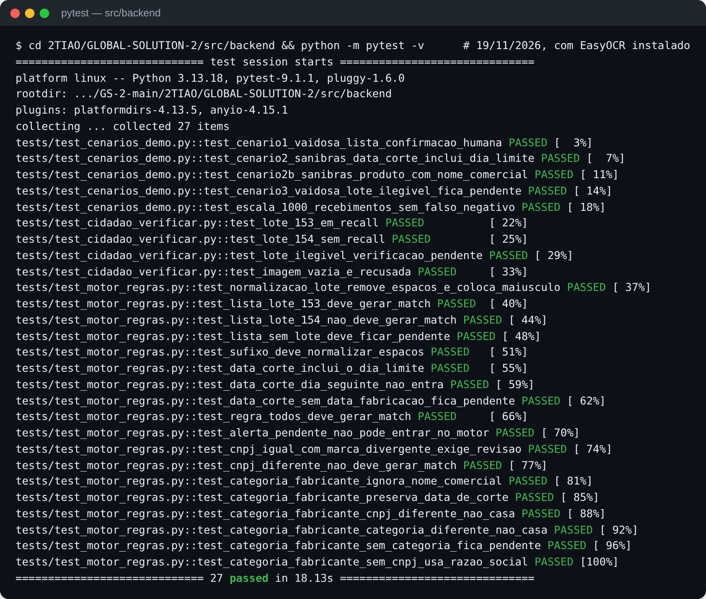
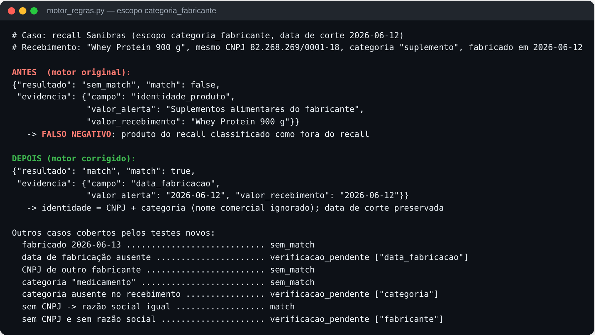
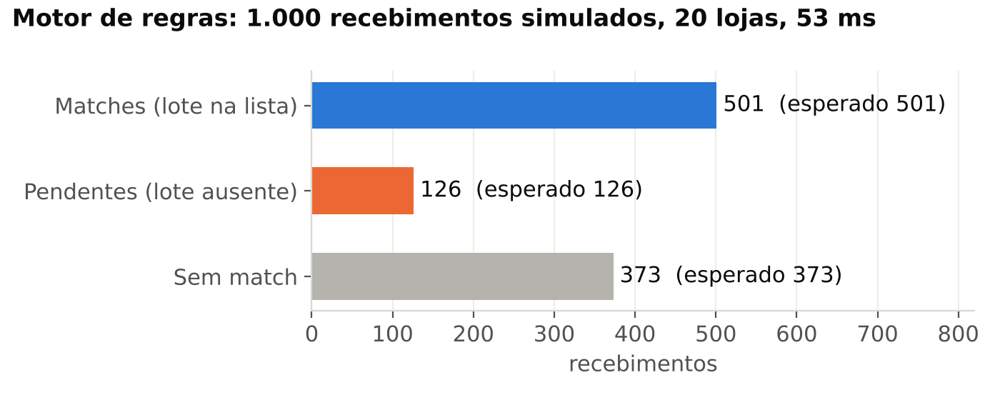
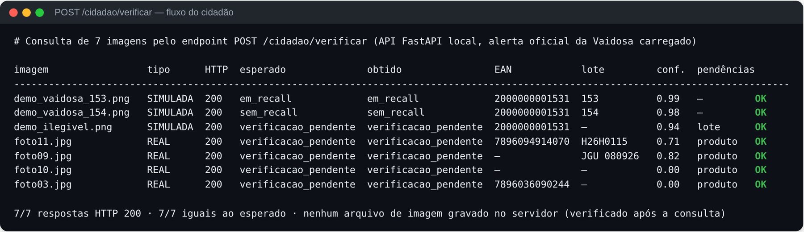
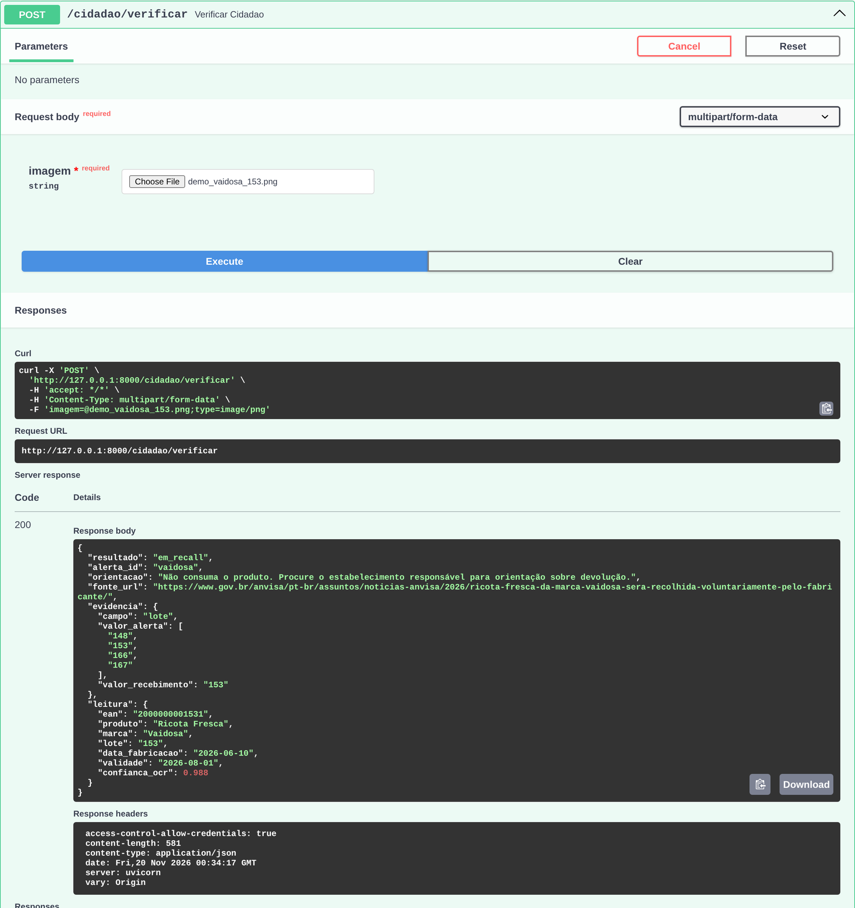
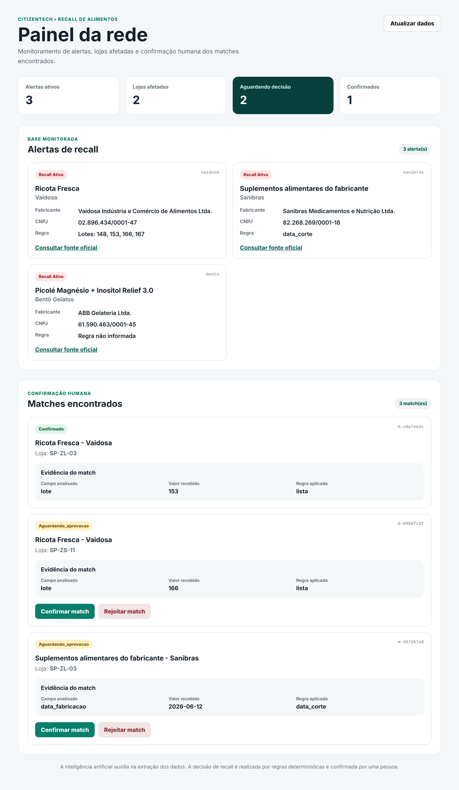

# Evidências de testes

Registro das execuções usadas no README e no PDF. Executado em **19/11/2026**.

## 1. Suítes automatizadas (pytest)

| Suíte | Comando (a partir de `src/`) | Resultado |
|---|---|---|
| IA — schemas, prompt, extrator, Gemini, métricas, leitor OCR | `cd ia && python -m pytest` | **187 passed, 6 skipped, 1 failed** (194 testes) |
| Backend completo — motor (18), cenários de demo (5) e fluxo do cidadão (4) | `cd backend && python -m pytest -v` | **27 passed** (com EasyOCR instalado; sem ele, 23 passed e 1 skipped) |



**Sobre os 6 skipped e o 1 failed da IA (ambiente, não código):**

- *Skipped:* 5 testes de integração do EasyOCR (pacote de ~100 MB não instalado no ambiente de verificação) e 1 teste de integração com o Gemini (sem `GEMINI_API_KEY`). Os resultados reais dessas integrações estão em `resultados_ocr.md` e `resultados_extracao.md`.
- *Failed:* `test_avaliar_ocr` reconstrói a versão anterior do leitor com `git show 07fcf16^:...`. Falha quando o repositório é baixado como ZIP (sem a pasta `.git`). Em um `git clone` o teste passa.

## 2. Cenários de demonstração (API FastAPI)

Fonte dos alertas: registros **reais** `vaidosa` e `sanibras` do `data/Golden_Set_Recall.json`. Recebimentos **simulados** (`simulado: true`). Código: `src/backend/tests/test_cenarios_demo.py`.

### Cenário 1 — Vaidosa · lista de lotes (148, 153, 166, 167)

Entrada: Loja A lote `153`, Loja B lote `154`.

```json
{"loja_id": "LOJA-A", "resultado": "match", "match": true,
 "evidencia": {"campo": "lote", "valor_alerta": ["148","153","166","167"], "valor_recebimento": "153"}}
{"loja_id": "LOJA-B", "resultado": "sem_match", "match": false,
 "evidencia": {"campo": "lote", "valor_alerta": ["148","153","166","167"], "valor_recebimento": "154"}}
```

Decisão humana (`POST /matches/{id}/decisao`):

```json
{"match_id": "m-7b2dd14d", "alerta_id": "vaidosa", "loja_id": "LOJA-A", "regra_aplicada": "lista",
 "status": "confirmado",
 "decisao": {"responsavel": "qualidade.loja03", "motivo": null, "em": "2026-11-19T20:58:14+00:00"}}
```

Segunda decisão sobre o mesmo match → **HTTP 409** ("Este match já possui uma decisão").

### Cenário 2 — Sanibras · data de corte (fabricado até 2026-06-12)

```json
{"loja_id": "LOJA-A", "resultado": "match",
 "evidencia": {"campo": "data_fabricacao", "valor_alerta": "2026-06-12", "valor_recebimento": "2026-06-12"}}
{"loja_id": "LOJA-B", "resultado": "sem_match",
 "evidencia": {"campo": "data_fabricacao", "valor_alerta": "2026-06-12", "valor_recebimento": "2026-06-13"}}
```

O dia limite é **incluído** e a regra usa a **data de fabricação**, não a validade.

**Correção do escopo `categoria_fabricante` (19/11/2026).** Antes, um suplemento com nome comercial próprio (ex.: `Whey Protein 900 g`, mesmo CNPJ, fabricado em 2026-06-12) recebia `sem_match`, porque o motor comparava o nome com `Suplementos alimentares do fabricante` — um **falso negativo**. Agora, quando o alerta tem `escopo = categoria_fabricante` (contrato v2, campo que o extrator já devolve para a Sanibras), a identidade é **fabricante (CNPJ; sem CNPJ, razão social) + categoria**, sem usar o nome comercial. As regras de lote e de data de corte continuam iguais. Fabricante ou categoria ausentes → `verificacao_pendente` com o campo faltante.



| Recebimento (alerta Sanibras, corte 2026-06-12) | Resultado |
|---|---|
| Whey Protein 900 g, mesmo CNPJ, suplemento, fab. 2026-06-12 | `match` |
| idem, fab. 2026-06-13 | `sem_match` |
| idem, sem data de fabricação | `verificacao_pendente` `["data_fabricacao"]` |
| outro CNPJ | `sem_match` |
| categoria `medicamento` | `sem_match` |
| sem categoria | `verificacao_pendente` `["categoria"]` |
| sem CNPJ, mesma razão social | `match` |
| sem CNPJ e sem razão social | `verificacao_pendente` `["fabricante"]` |

Observação: o registro `sanibras` do golden set ainda não tem `escopo`/`categoria` (pendência da PO); o teste acrescenta esses dois campos exatamente como o extrator os devolve (`docs/resultados_extracao_execucao.json`).

### Cenário 3 — Vaidosa · lote ilegível

```json
{"loja_id": "LOJA-C", "resultado": "verificacao_pendente", "motivos": ["lote"], "evidencia": null}
{"loja_id": "LOJA-D", "resultado": "verificacao_pendente", "motivos": ["lote"], "evidencia": null}
```

Lote só com espaços e lote `null` ficam pendentes; nenhum match conclusivo é criado.

### Teste de escala

| Recebimentos | Lojas | Matches (esperado) | Pendentes (esperado) | Tempo |
|---|---|---|---|---|
| 1.000 | 20 | **501 (501)** | **126 (126)** | **53 ms** |



## 3. Fluxo do cidadão — `POST /cidadao/verificar`

Backend FastAPI iniciado localmente, alerta oficial da Vaidosa carregado, imagens enviadas por `multipart/form-data` (campo `imagem`). Teste automatizado: `src/backend/tests/test_cidadao_verificar.py`.



| Imagem | Tipo | Esperado | Obtido | Leitura |
|---|---|---|---|---|
| `demo_vaidosa_153.png` | simulada | `em_recall` | ✅ `em_recall` | EAN 2000000001531, lote 153, confiança 0,99 |
| `demo_vaidosa_154.png` | simulada | `sem_recall` | ✅ `sem_recall` | lote 154, confiança 0,98 |
| `demo_ilegivel.png` | simulada | `verificacao_pendente` | ✅ `verificacao_pendente` | pendência `lote` |
| `foto11.jpg` | real | `verificacao_pendente` | ✅ | lote H26H0115 lido; EAN fora do catálogo da demo → pendência `produto` |
| `foto09.jpg` | real | `verificacao_pendente` | ✅ | lote JGU 080926 lido; sem EAN → pendência `produto` |
| `foto10.jpg` | real | `verificacao_pendente` | ✅ | controle negativo (lote ilegível) |
| `foto03.jpg` | real | `verificacao_pendente` | ✅ | EAN lido; lote fora do quadro |

- **7/7 respostas HTTP 200**, todas iguais ao esperado; imagem vazia → **HTTP 400**.
- Nenhum arquivo de imagem foi gravado no servidor após a consulta (verificado no sistema de arquivos).
- Fotos reais ficam pendentes porque o catálogo EAN → produto da POC só contém o EAN fictício da demo; é o comportamento seguro previsto (sem resposta conclusiva sem identificar o produto).
- **Interface do cidadão:** **não operacional** — `src/app-cidadao/src/App.jsx` ainda é cópia do painel da rede e não tem tela de envio de foto. O fluxo foi validado pela API e pela documentação interativa (Swagger).



## 4. Painel da rede (captura de 19/11/2026)

API local + painel React com os cenários 1 e 2 carregados e o match da loja SP-ZL-03 já confirmado:



Observação: o alerta `bento` (sem regra de lote, `verificacao_pendente`) aparece com o selo "Recall Ativo". O selo deveria refletir `status_extracao` (melhoria registrada em `revisao_entrega_checklist.md`).

## 5. Extração e OCR

- Extração (Gemini): [`resultados_extracao.md`](resultados_extracao.md) — regra correta em 25/26, 0 falsos "sem recall", 0 alucinações.
- OCR: [`resultados_ocr.md`](resultados_ocr.md) — 0/12 erros confiantes, EAN 6/6, lote 4/7.

## 6. Ainda não medido

- **Tempo manual × automatizado** com cronômetro e o mesmo conjunto de alertas e recebimentos (métrica prevista na Nota de Produto). O tempo automatizado já está medido (53 ms / 1.000 recebimentos); falta o fluxo manual.
- **Interface do app do cidadão** (a API já foi validada; falta a tela).
