# 🖼️ Diretório de referência — imagens e gráficos

Todas as imagens usadas no [README do projeto](../../README.md), no [PDF da entrega](../GS2026-2_Recall_Seguro.pdf) e na documentação. Cada imagem tem origem rastreável: dados do repositório, execução de testes ou captura da aplicação rodando.

| Pasta | Conteúdo |
|---|---|
| [`capa/`](capa) | Banner do projeto e logo da FIAP |
| [`destaques/`](destaques) | Cartões de indicadores, fluxo "como funciona" e princípios |
| [`diagramas/`](diagramas) | Arquitetura (horizontal, vertical e fonte Mermaid) |
| [`graficos/`](graficos) | Gráficos de problema, extração, motor e OCR |
| [`telas/`](telas) | Capturas do painel da rede rodando com a API |
| [`exemplos/`](exemplos) | Galeria de leitura de embalagens (fotos reais × imagens simuladas) |
| [`evidencias/`](evidencias) | Prints dos testes, da correção do motor e do endpoint do cidadão (19/11/2026) |
| [`fontes/`](fontes) | Scripts e HTML que geram as imagens acima |

## Catálogo

### Capa e destaques

| Imagem | Descrição | Origem | Usada em |
|---|---|---|---|
| 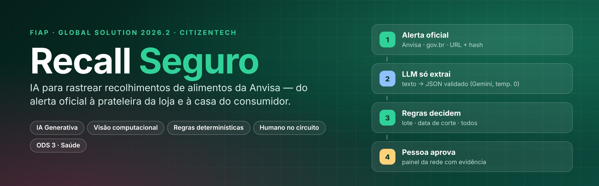 `capa/banner.jpg` | Banner: nome, proposta e fluxo em 4 passos | `fontes/visuais.html` (#banner) | README |
|  `capa/logo-fiap.png` | Logo FIAP | template FIAP-PORTFOLIO-AI | PDF (capa) |
| 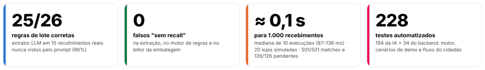 `destaques/kpis.png` | 25/26 regras corretas · 0 falsos "sem recall" · 53 ms · 206 testes | `fontes/visuais.html` (#kpis) | README |
| 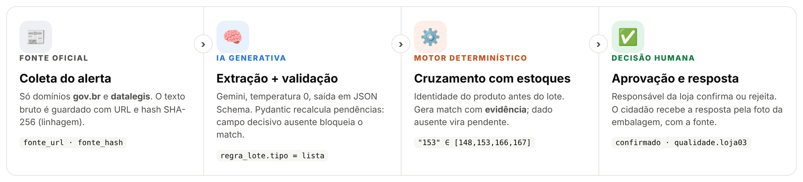 `destaques/fluxo.png` | Coleta → extração → cruzamento → decisão humana | `fontes/visuais.html` (#fluxo) | README |
| 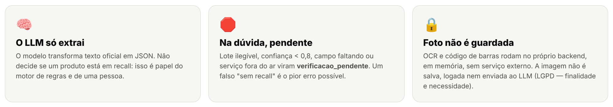 `destaques/principios.png` | LLM só extrai · na dúvida, pendente · foto não é guardada | `fontes/visuais.html` (#principios) | README |

### Diagramas

| Imagem | Descrição | Origem | Usada em |
|---|---|---|---|
| 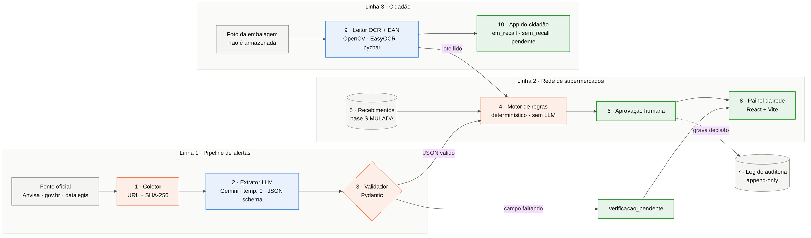 `diagramas/arquitetura.png` | Arquitetura em 3 linhas (horizontal) | `diagramas/arquitetura.mmd` (Mermaid CLI) | README, raiz, `arquitetura.md` |
| 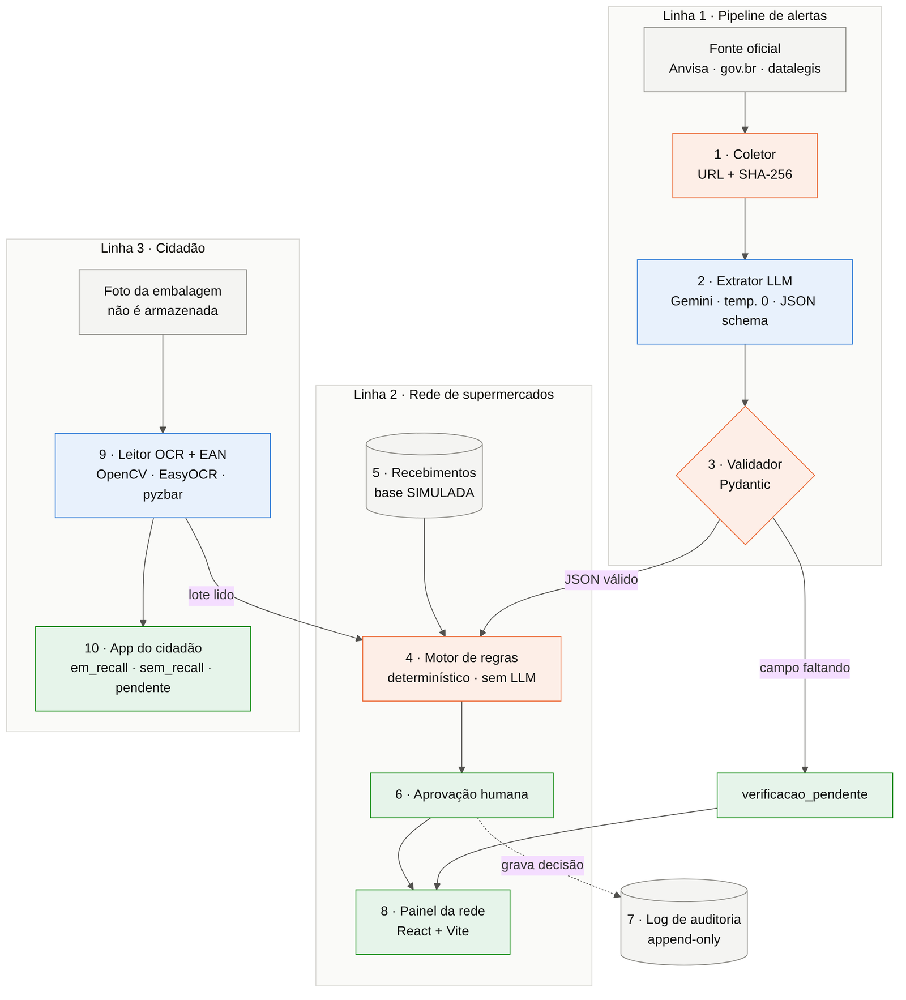 `diagramas/arquitetura_vertical.png` | Mesma arquitetura, vertical (página A4) | `arquitetura.mmd` com `flowchart TB` | PDF |

### Gráficos

| Imagem | Descrição | Fonte dos dados | Usada em |
|---|---|---|---|
| 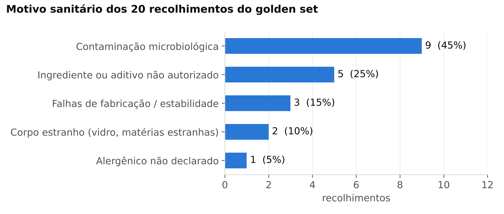 `recolhimentos_motivos.png` | Motivo sanitário dos 20 recolhimentos | `data/Dataset_Recall_Anvisa.xlsx` | README, PDF |
| 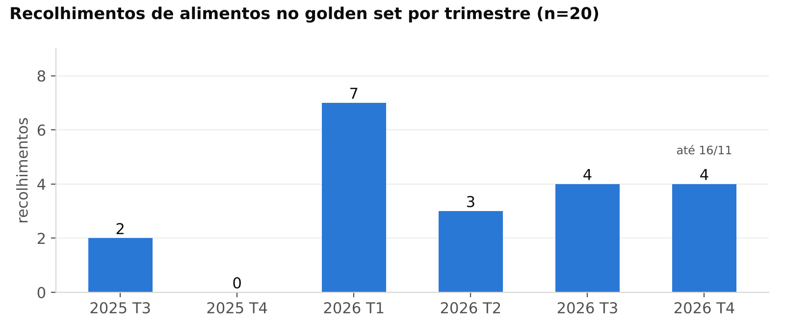 `recolhimentos_trimestre.png` | Recolhimentos por trimestre | `data/Dataset_Recall_Anvisa.xlsx` | README, PDF |
| 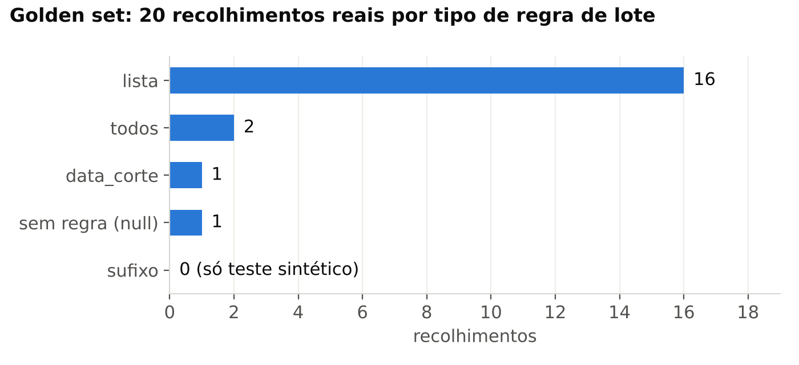 `golden_set_tipos.png` | Golden set por tipo de regra | `data/Golden_Set_Recall.json` | README, PDF |
| 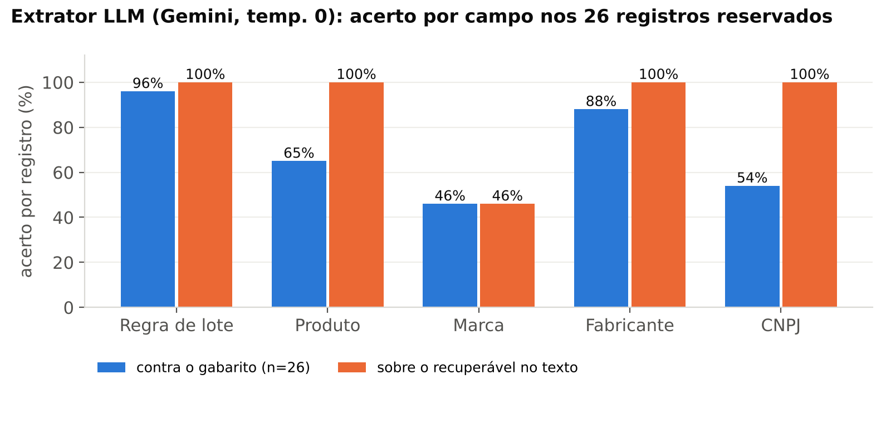 `extracao_por_campo.png` | Acerto do extrator por campo | `docs/resultados_extracao.md` | README, PDF |
| 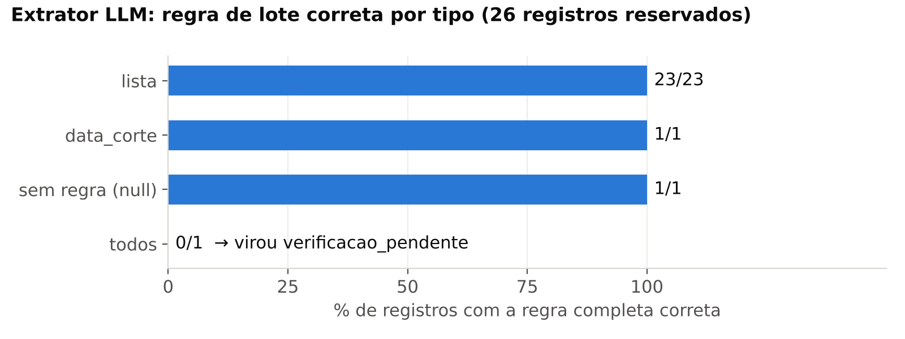 `extracao_por_tipo.png` | Regra correta por tipo | `docs/resultados_extracao.md` | README, PDF |
| 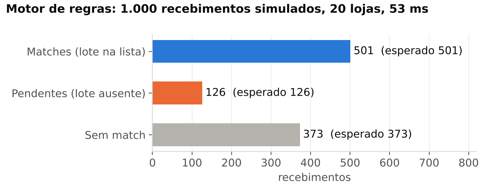 `motor_escala.png` | Motor com 1.000 recebimentos | `src/backend/tests/test_cenarios_demo.py` | README, PDF, `evidencias_testes.md` |
| 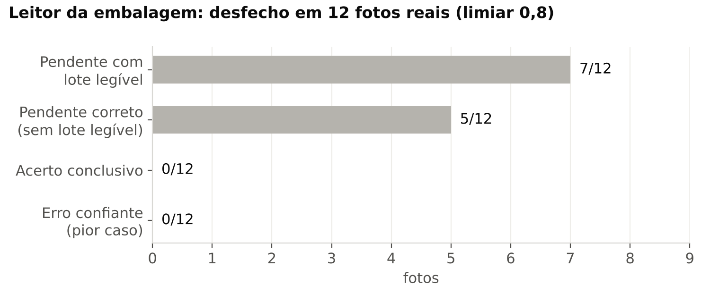 `ocr_desfechos.png` | Desfecho das 12 fotos reais | `docs/resultados_ocr.md` | README, PDF |
| 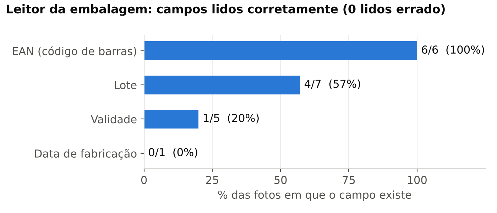 `ocr_por_campo.png` | Campos lidos corretamente | `docs/resultados_ocr.md` | README, PDF |

### Telas e exemplos

| Imagem | Descrição | Origem | Usada em |
|---|---|---|---|
| 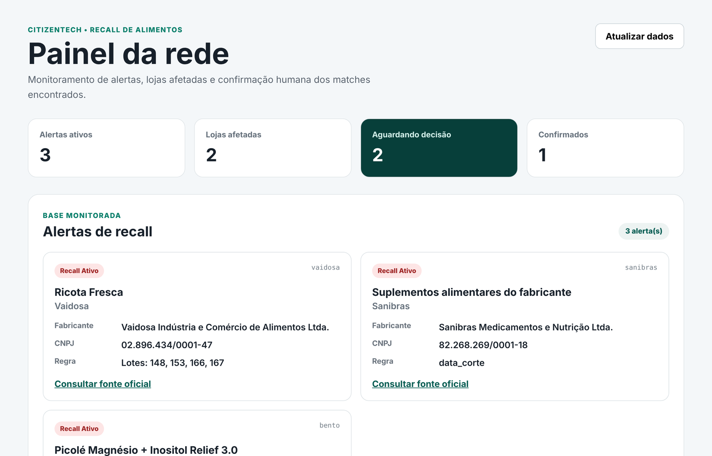 `telas/painel_topo.png` | Indicadores e alertas | Captura do painel (19/11/2026) com cenários 1 e 2 carregados | README, PDF, `src/painel/README.md` |
| 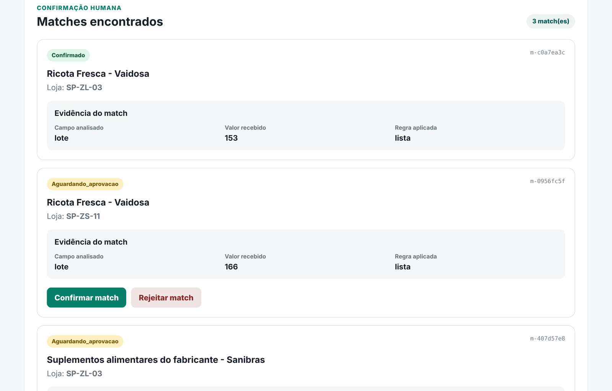 `telas/painel_matches.png` | Matches com evidência e aprovação | Mesma sessão | README, PDF |
| 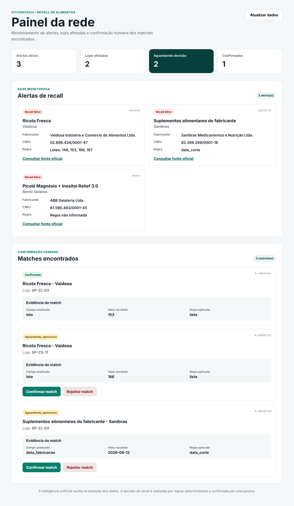 `telas/painel_rede.png` | Página inteira do painel | Mesma sessão | `evidencias_testes.md` |
| 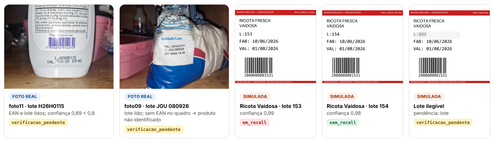 `exemplos/galeria.png` | 2 fotos reais (pendentes) + 3 imagens simuladas da demo | `data/fotos_teste/`, `data/demo/`, `fontes/visuais.html` (#galeria) | README |

### Evidências (19/11/2026)

| Imagem | Descrição | Origem | Usada em |
|---|---|---|---|
| 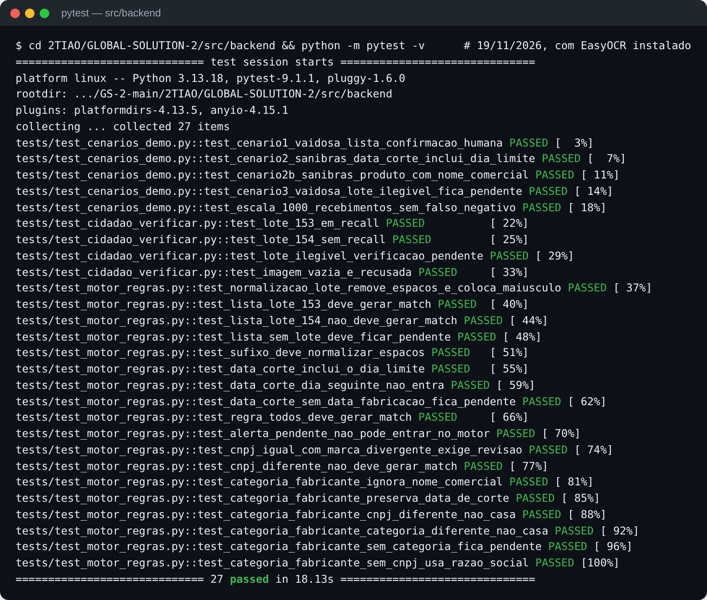 `print_pytest_backend.png` | `python -m pytest -v` no backend: 27 passed | execução real | `evidencias_testes.md` |
| 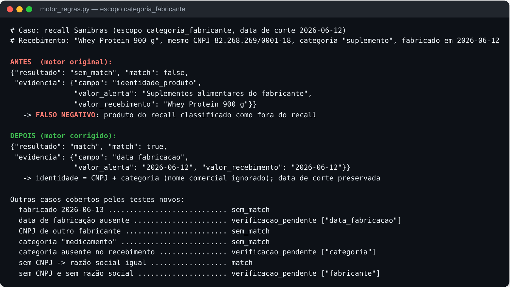 `print_correcao_categoria_fabricante.png` | Caso Sanibras antes × depois da correção | motor original × corrigido, mesmo alerta e recebimento | `evidencias_testes.md` |
| 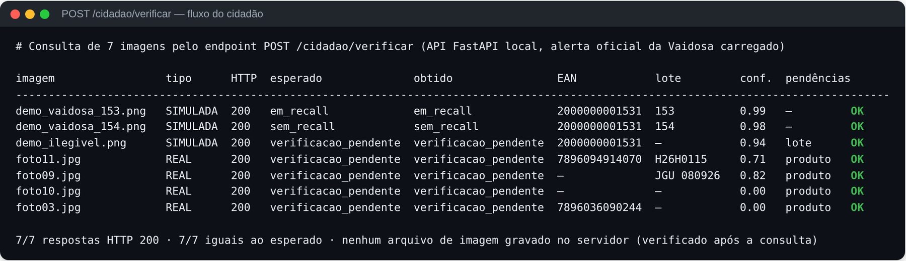 `print_cidadao_resultados.png` | 7 imagens em `POST /cidadao/verificar` | API local com EasyOCR | `evidencias_testes.md` |
| 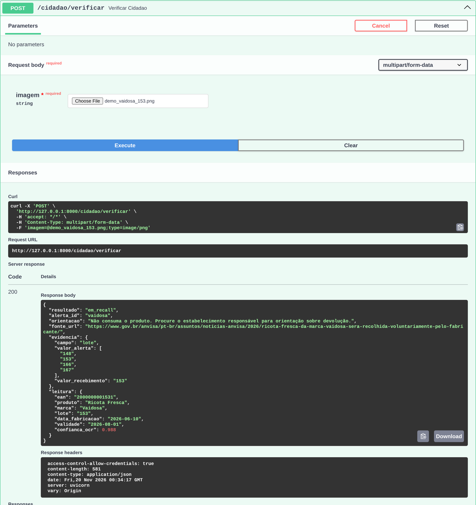 `print_swagger_cidadao_em_recall.png` | Swagger executando o endpoint com `demo_vaidosa_153.png` → `em_recall` | `/docs` da API local | `evidencias_testes.md` |

## Como regerar

```bash
# gráficos (a partir da raiz do repositório)
pip install matplotlib openpyxl
python 2TIAO/GLOBAL-SOLUTION-2/docs/img/fontes/gerar_graficos.py

# diagrama
npx @mermaid-js/mermaid-cli -i 2TIAO/GLOBAL-SOLUTION-2/docs/img/diagramas/arquitetura.mmd \
    -o 2TIAO/GLOBAL-SOLUTION-2/docs/img/diagramas/arquitetura.png -w 1800 -s 2 -b white
```

Banner, destaques e galeria: abrir `fontes/visuais.html` no navegador e capturar cada bloco (`#banner`, `#kpis`, `#fluxo`, `#galeria`, `#principios`) em escala 2×.

**Padrões visuais:** azul `#2a78d6` e laranja `#eb6834` (par validado para daltonismo) e cinza neutro nos gráficos; verde-escuro `#06352b` e menta `#2fd39a` na capa; rosa FIAP `#ed145b` como destaque. Os dados simulados aparecem sempre marcados como **SIMULADA**.
