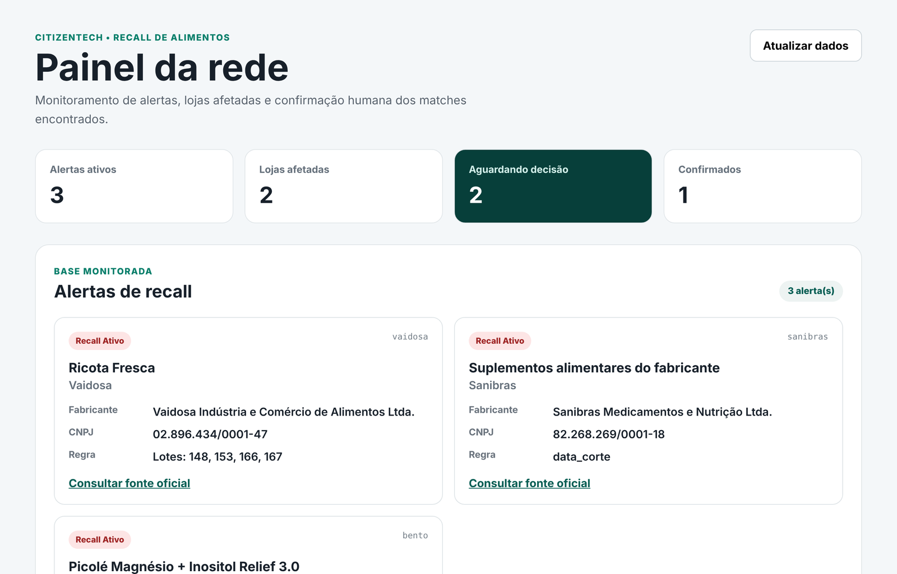

# Painel da rede (React + Vite)

Tela do **responsável de qualidade** da rede de supermercados.



## O que mostra

- **Indicadores:** alertas ativos, lojas afetadas, matches aguardando decisão e confirmados.
- **Alertas de recall:** produto, marca, fabricante, CNPJ, regra de lote e link para a **fonte oficial**.
- **Matches encontrados:** loja, evidência (campo analisado, valor recebido, regra aplicada) e botões **Confirmar / Rejeitar** (decisão humana).
- Rodapé: "A IA auxilia na extração dos dados. A decisão de recall é realizada por regras determinísticas e confirmada por uma pessoa."

## Como executar

```bash
# API rodando em http://127.0.0.1:8000 (ver src/backend/README.md)
cd 2TIAO/GLOBAL-SOLUTION-2/src/painel
npm install
npm run dev        # http://localhost:5173
```

A URL da API está em `src/App.jsx` (`API_URL`). Como a API guarda os dados em memória, carregue um cenário com `POST /motor/processar` (exemplos em `src/backend/tests/test_cenarios_demo.py`) antes de abrir o painel.

## Melhorias conhecidas

- Selo do alerta deve refletir `status_extracao` (alerta pendente aparece como "Recall Ativo").
- Exibir `campos_pendentes` e `revisao_manual` no cartão do match.
