# FIAP - Faculdade de Informática e Administração Paulista

<p align="center">
<a href="https://www.fiap.com.br/">
  
</a>
</p>

<p align="center">
  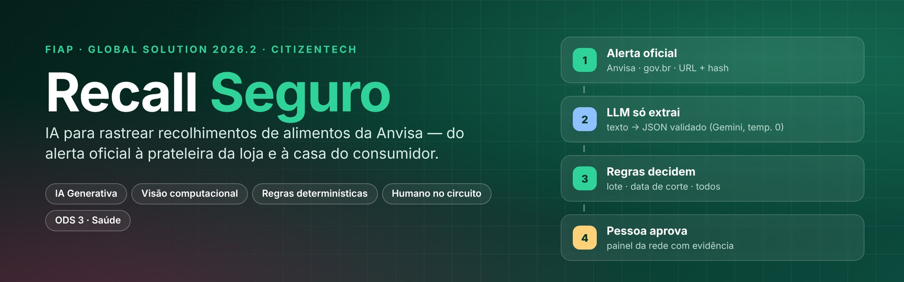
</p>

<p align="center">
  
  
  
  
  
  
  
  
</p>

<p align="center">
  <b><a href="2TIAO/GLOBAL-SOLUTION-2/docs/GS2026-2_Recall_Seguro.pdf">📄 PDF da entrega</a></b> ·
  <b>🎬 Vídeo: <code>[PREENCHER]</code></b> ·
  <b><a href="#resultados">📊 Resultados</a></b> ·
  <b><a href="#como-executar">🔧 Como executar</a></b> ·
  <b><a href="2TIAO/GLOBAL-SOLUTION-2/docs/revisao_entrega_checklist.md">✅ Checklist da entrega</a></b> ·
  <b><a href="https://github.com/Carlos566487/GLOBAL_SOLUTION_2026_2">💻 Repositório</a></b>
</p>

---

## ⚡ Em 30 segundos

> Quando a Anvisa publica um recolhimento, a rede de supermercados precisa saber **quais lojas receberam o lote afetado**, e o cidadão precisa saber **se o produto que tem em casa está em recall**. O **Recall Seguro** usa um **LLM para extrair a regra de lote** do texto oficial, um **motor de regras determinístico** para cruzar com os estoques e **uma pessoa para aprovar** cada ação. O cidadão consulta pela **foto da embalagem**.

<p align="center">
  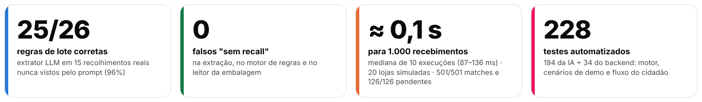
</p>

---

## 📑 Sumário

| | | |
|---|---|---|
| 1. [Equipe](#equipe) | 5. [Dados](#dados) | 9. [ODS 3 e impacto](#ods) |
| 2. [O problema](#problema) | 6. [Tecnologias](#tecnologias) | 10. [Governança e LGPD](#governanca) |
| 3. [Como funciona](#como-funciona) | 7. [Resultados](#resultados) | 11. [Como executar](#como-executar) |
| 4. [Arquitetura](#arquitetura) | 8. [Telas e demonstração](#telas) | 12. [Limitações, próximos passos e estrutura](#limitacoes) |

---

<a id="equipe"></a>

## 👥 Equipe

| Nome | RM | Função |
|---|---:|---|
| Tayná Esteves | RM562491 | 🚀 Product Owner & Pesquisadora |
| João | RM565999 | 🔧 Engenheiro de IA |
| Endrew Alves | RM563646 | 🎨 Dev Full-Stack |
| Carlos Eduardo | RM566487 | 📄 Tech Lead & Documentador |

**Turma:** `[PREENCHER]` · **Participação na competição:** [x] Sim, aceitamos participar / [ ] Não vamos participar.

### 👩‍🏫 Professores

- **Tutor turma A:** [Caique Nonato da Silva Bezerra](https://www.linkedin.com/in/caique-nonato/) — profcaique.bezerra@fiap.com.br
- **Tutor turma R:** [Leonardo Ruiz Orabona](https://www.linkedin.com/in/leonardoorabona/) — profleonardo.orabona@fiap.com.br
- **Coordenador:** [André Godoi Chiovato](https://www.linkedin.com/in/andregodoichiovato/) — profandre.chiovato@fiap.com.br

---

<a id="problema"></a>

## 🚨 O problema

O grupo levantou **27 recolhimentos de alimentos** por motivos sanitários em fontes oficiais entre **01/01/2025 e 16/11/2026**; **20** foram rotulados à mão (golden set). Quase metade é **contaminação microbiológica** (Listeria, Salmonella, cereulida) e **2 envolvem fórmulas infantis**.

<table>
<tr>
<td width="50%">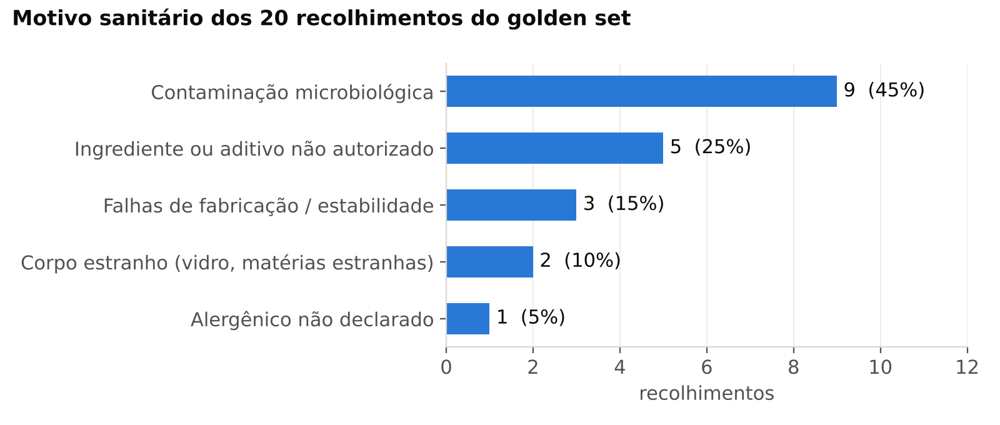</td>
<td width="50%">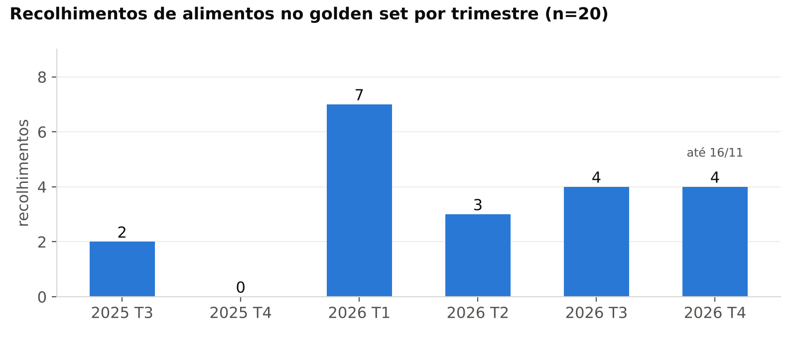</td>
</tr>
</table>

Cada alerta descreve o lote afetado **de um jeito diferente**, em texto livre — por isso a extração precisa de IA, e a decisão precisa de regras:

| Tipo de regra | Exemplo real | O que a loja compara |
|---|---|---|
| `lista` | Ricota Fresca **Vaidosa**: lotes 148, 153, 166 e 167 ([Anvisa, 24/07/2026](https://www.gov.br/anvisa/pt-br/assuntos/noticias-anvisa/2026/ricota-fresca-da-marca-vaidosa-sera-recolhida-voluntariamente-pelo-fabricante)) | lote ∈ lista |
| `data_corte` | **Sanibras**: suplementos fabricados até 12/06/2026 | data de fabricação ≤ limite |
| `todos` | **Equaliv**, **Nutra**: todos os lotes do produto | só a identidade |
| `sufixo` | lotes terminados em um código (teste sintético) | lote termina com o sufixo |

**Quem é afetado:**

| 🧑‍🤝‍🧑 Cidadão / consumidor | 🏬 Responsável de qualidade da rede |
|---|---|
| Não fica sabendo do alerta ou não sabe ler o lote da embalagem. **Recebe:** consulta por foto com resposta, orientação e link da fonte oficial. | Procura o lote manualmente em planilhas de cada loja ou retira a marca inteira. **Recebe:** painel com lojas afetadas, evidência e botão de aprovação. |

> ⚠️ **Por que só fonte oficial?** Um site não oficial publicou o recall da ricota com os lotes `L2305A` a `L2308D`, que **não existem** no comunicado da Anvisa. O sistema só aceita `*.gov.br` e `datalegis.net`.

---

<a id="como-funciona"></a>

## 🧭 Como funciona

<p align="center">
  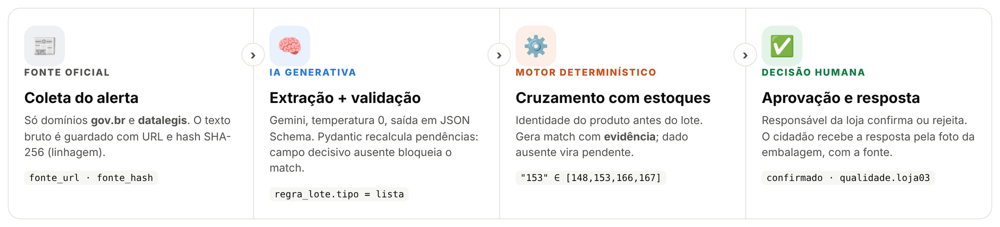
</p>

<p align="center">
  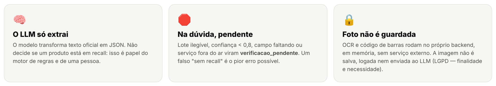
</p>

---

<a id="arquitetura"></a>

## 🏗️ Arquitetura

<p align="center">
  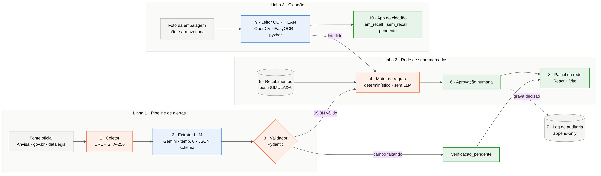
</p>

<details>
<summary><b>🔍 Consulta do cidadão, passo a passo (diagrama de sequência)</b></summary>

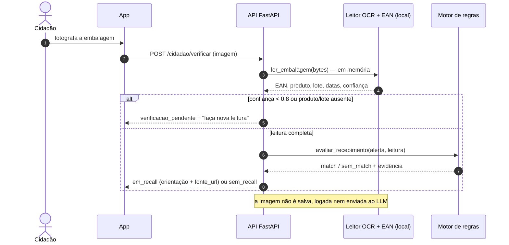

</details>

<details>
<summary><b>🏬 Fluxo da rede: do alerta à decisão humana (diagrama de sequência)</b></summary>

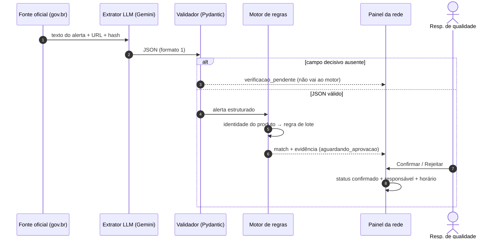

</details>

| Método | Rota | Função |
|---|---|---|
| `POST` | `/alertas/coletar` | Texto oficial + URL → extrator LLM + validador |
| `GET` | `/alertas` | Alertas extraídos |
| `POST` | `/motor/processar` | Cruza um alerta com recebimentos |
| `GET` | `/matches?alerta_id=` | Matches com evidência e status |
| `POST` | `/matches/{id}/decisao` | Decisão humana; **409** se já decidido |
| `POST` | `/cidadao/verificar` | Foto → `em_recall` · `sem_recall` · `verificacao_pendente` |

Contratos de dados e regras do motor: [`docs/arquitetura.md`](2TIAO/GLOBAL-SOLUTION-2/docs/arquitetura.md).

---

<a id="dados"></a>

## 🗂️ Dados: origem, tratamento e limitações

| Conjunto | Natureza | Volume | Onde |
|---|---|---|---|
| Levantamento de recolhimentos | 🟢 **Real** (Anvisa, Prefeitura SP, datalegis) | 27 recolhimentos | `data/Dataset_Recall_Anvisa.xlsx` |
| Golden set (gabarito) | 🟢 **Real**, rotulado à mão | 20 recolhimentos · 36 registros | `data/Golden_Set_Recall.json` |
| Textos oficiais | 🟢 **Real** | 20 textos | `data/textos_avaliacao/` |
| Fotos de embalagens | 🟢 **Reais, próprias** (sem EXIF, sem pessoas) | 12 fotos | `data/fotos_teste/` |
| Imagens da demo | 🟠 **Simuladas** (faixa "IMAGEM SIMULADA") | 3 | `data/demo/` |
| Recebimentos das lojas | 🟠 **Simulados** (`simulado: true`) | até 1.000 · 20 lojas | `src/backend/tests/test_cenarios_demo.py` |

<table>
<tr>
<td width="55%">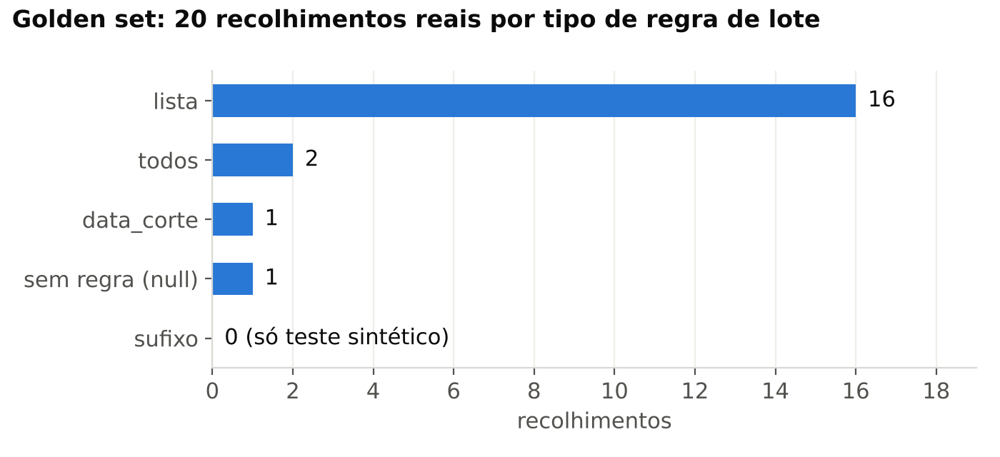</td>
<td width="45%">

**Tratamento**

- Lote é **sempre texto**: `strip` + maiúsculas; zeros à esquerda preservados (`07225288 ≠ 7225288`).
- Golden set dividido **antes** do prompt: 5 recolhimentos como exemplos, **15 reservados** para avaliação; teste automático de vazamento.
- Só fontes oficiais; linhagem por URL + SHA-256.

**Limitações:** amostra pequena e concentrada em `lista`; `sufixo` sem caso real; estoques fictícios.

</td>
</tr>
</table>

---

<a id="tecnologias"></a>

## 🛠️ Tecnologias e justificativas

| Camada | Tecnologia | Por quê |
|---|---|---|
| 🧠 Extração | **Gemini** `gemini-3.5-flash-lite`, temperatura 0, JSON Schema, few-shot | Texto livre → estrutura; nulos explícitos reduzem invenção; 100% de disponibilidade nos testes e menor custo |
| ✅ Validação | **Pydantic v2** | Recalcula `campos_pendentes`: o LLM não consegue "retirar" uma pendência |
| ⚙️ Decisão | **Python puro** | Determinístico, explicável, testável |
| 👁️ Visão | **OpenCV** + **EasyOCR** + **pyzbar** | Lote/datas por OCR e EAN por código de barras, sem serviço externo |
| 🌐 API | **FastAPI** | Um backend para painel e app; OpenAPI automático |
| 🖥️ Front-end | **React 19 + Vite** | Painel com indicadores, evidência e aprovação |
| 🧪 Qualidade | **pytest** | 228 testes: 194 da IA + 34 do backend (motor, cenários de demo e fluxo do cidadão) |

---

<a id="resultados"></a>

## 📊 Resultados

### 🧠 Extrator LLM — 15 recolhimentos reais nunca vistos pelo prompt (26 registros)

<table>
<tr>
<td width="55%">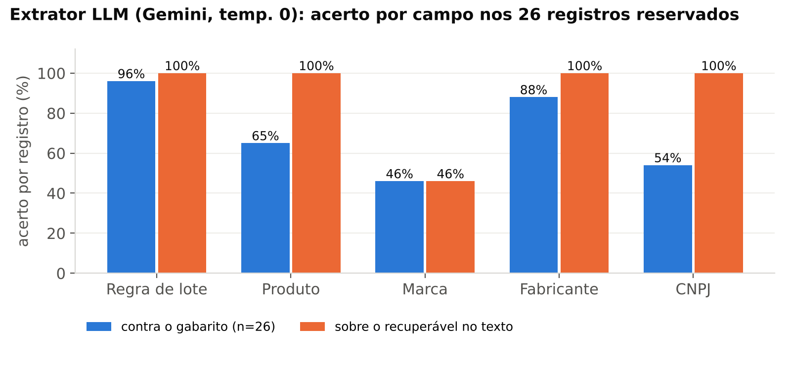</td>
<td width="45%">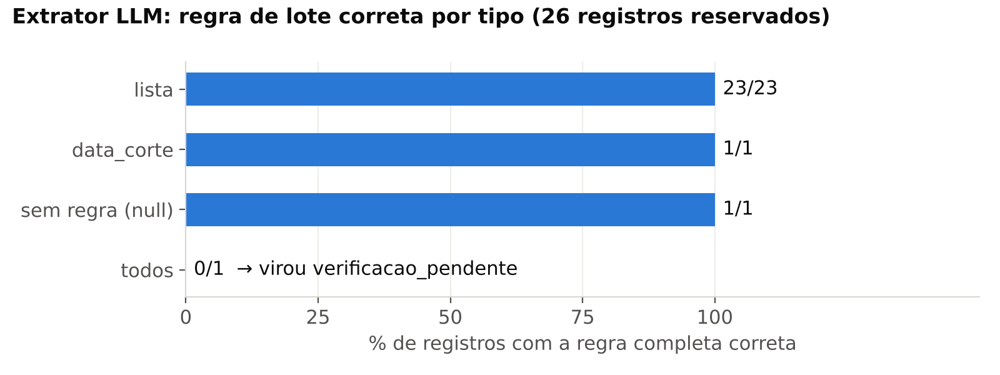</td>
</tr>
</table>

| Indicador | Resultado |
|---|---|
| **Regra de lote correta** | ✅ **25/26 (96%)** — o único erro virou `verificacao_pendente` |
| **Falsos "sem recall"** | ✅ **0** |
| **Alucinações** (11 alertas não rotulados) | ✅ **0** — todos sustentados por trecho literal do texto |
| Erros de identidade | 25 de 39 são valores **ausentes do texto**; erros reais concentram-se em **marca** (14) |

### ⚙️ Motor de regras — cenários de demonstração pela API

| Cenário | Entrada (simulada) | Esperado | Observado |
|---|---|---|---|
| 1 · Vaidosa · `lista` | lote `153` × `154` | match → confirmado · sem match | ✅ `confirmado` por `qualidade.loja03`; 2ª decisão → **409** |
| 2 · Sanibras · `data_corte` | fabricação 12/06 × 13/06 | match (dia limite incluso) · sem match | ✅ |
| 3 · Vaidosa · lote ilegível | `"   "` e `null` | `verificacao_pendente` `["lote"]` | ✅ |
| Escala | 1.000 recebimentos · 20 lojas | 501 matches · 126 pendentes | ✅ 501/501 · 126/126 · **≈ 0,1 s** (mediana 102 ms, 10 execuções) |
| 2b · Sanibras com nome comercial | "Whey Protein 900 g", mesmo CNPJ, categoria suplemento | match por fabricante + categoria | ✅ corrigido em 19/11 (antes era falso negativo) |

<p align="center">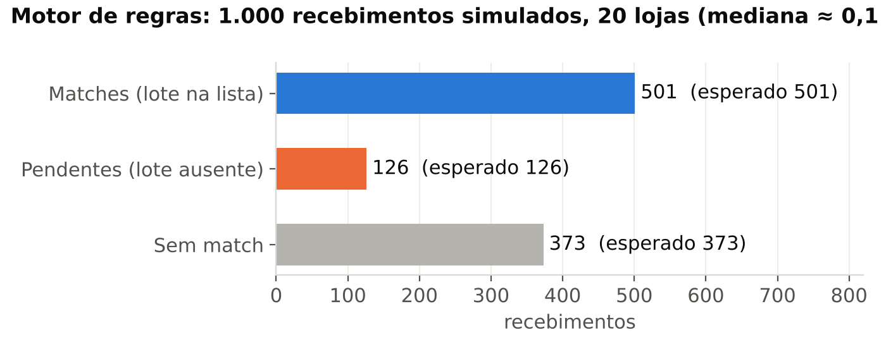</p>

### 👁️ Leitor da embalagem — 12 fotos reais

<table>
<tr>
<td width="50%">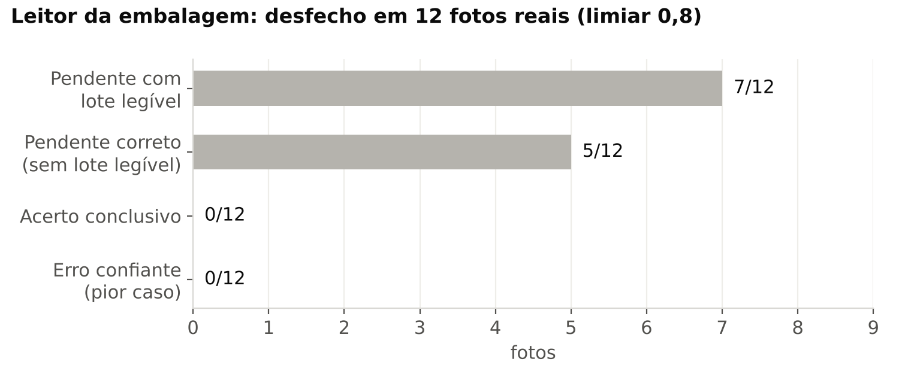</td>
<td width="50%">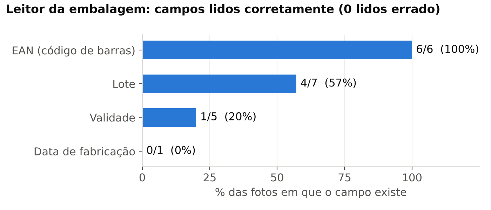</td>
</tr>
</table>

**0/12 erros confiantes** · **EAN 6/6** · **lote 4/7** · nenhum campo lido com valor errado. O leitor é **seguro, porém conservador**: ainda não deu resposta conclusiva em foto real (confiança < 0,8 ou EAN fora do quadro).

Relatórios completos: [`resultados_extracao.md`](2TIAO/GLOBAL-SOLUTION-2/docs/resultados_extracao.md) · [`resultados_ocr.md`](2TIAO/GLOBAL-SOLUTION-2/docs/resultados_ocr.md) · [`evidencias_testes.md`](2TIAO/GLOBAL-SOLUTION-2/docs/evidencias_testes.md)

---

<a id="telas"></a>

## 🖥️ Telas e demonstração

### Painel da rede (React + Vite)

<table>
<tr>
<td width="50%">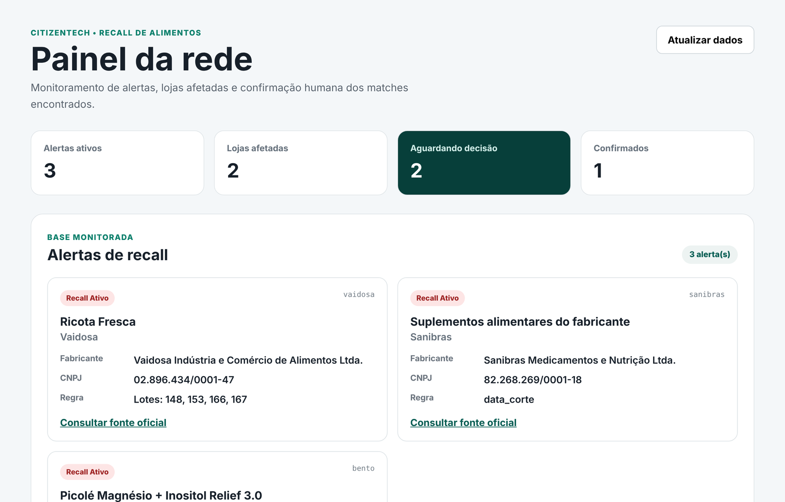</td>
<td width="50%">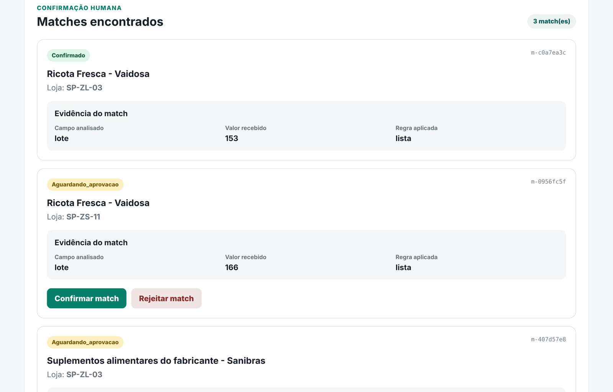</td>
</tr>
<tr>
<td align="center"><sub>Indicadores e alertas com link para a fonte oficial</sub></td>
<td align="center"><sub>Matches com evidência e aprovação humana</sub></td>
</tr>
</table>

### Leitura da embalagem: fotos reais × imagens simuladas da demo

<p align="center">
  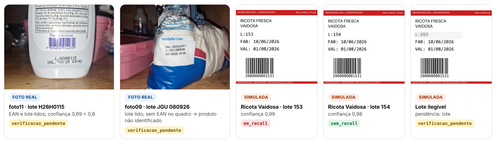
</p>

---

<a id="ods"></a>

## 🌍 ODS 3 — Saúde e Bem-Estar

**Meta 3.d** — reforçar a capacidade de alerta precoce, redução e gerenciamento de riscos à saúde. A solução encurta o caminho entre o alerta sanitário e a retirada do produto da prateleira e da casa do consumidor.

| Indicador | Como medir | POC | Meta em piloto |
|---|---|---|---|
| Regra de lote correta | corretas ÷ avaliadas, por tipo | **96%** | ≥ 95% com revisão humana |
| Falsos "sem recall" | afetados classificados como "sem recall" | **0** | 0 |
| Tempo de triagem | cronômetro manual × automatizado | **≈ 0,1 s / 1.000** (mediana; manual: a medir) | redução ≥ 90% |
| Lojas com ação em 24 h | confirmados ≤ 24 h ÷ matches | — | ≥ 90% |
| Consultas conclusivas do cidadão | conclusivas ÷ consultas | 0/12 fotos reais | ≥ 60% com guia de enquadramento |

Medir unidades retiradas e efeitos em saúde exige piloto com uma rede real (limitação declarada).

---

<a id="governanca"></a>

## 🛡️ Governança, privacidade (LGPD) e riscos

| | Controle |
|---|---|
| 🔗 **Rastreabilidade** | `fonte_url` oficial + `fonte_hash` SHA-256 em todo alerta; **evidência** em todo match; decisão humana com responsável e horário, imutável (409) |
| 🔒 **Privacidade** | Foto processada em memória, sem serviço externo; não é salva, logada nem enviada ao LLM (teste falha se gravar arquivo). Máscara de CPF/e-mail/telefone antes do LLM |
| 🧠 **Limites do LLM** | Temperatura 0, schema, sem poder de decisão, prompt versionado, fonte citada |
| ⚖️ **Vieses** | Gabarito concentrado em `lista` e grandes marcas; fotos de um único celular e ambiente |

Matriz com 8 riscos (5 críticos): [`Nota_de_Produto_e_Matriz_de_Riscos.md`](2TIAO/GLOBAL-SOLUTION-2/data/Nota_de_Produto_e_Matriz_de_Riscos.md) · [`ia_limites_e_riscos.md`](2TIAO/GLOBAL-SOLUTION-2/docs/ia_limites_e_riscos.md)

---

<a id="como-executar"></a>

## 🔧 Como executar

**Pré-requisitos:** Python 3.11+, Node.js 20+, chave do Google AI Studio (só para a extração).

```bash
# 1) Ambiente Python (na raiz do repositório)
python -m venv .venv
.venv\Scripts\activate                   # Linux/macOS: source .venv/bin/activate
pip install torch torchvision --index-url https://download.pytorch.org/whl/cpu
pip install -r 2TIAO/GLOBAL-SOLUTION-2/src/ia/requirements.txt
pip install -r 2TIAO/GLOBAL-SOLUTION-2/src/backend/requirements.txt
copy .env.example .env                   # preencha GEMINI_API_KEY

# 2) API (porta 8000)
cd 2TIAO/GLOBAL-SOLUTION-2/src
uvicorn backend.app.main:app --reload    # http://127.0.0.1:8000/docs

# 3) Painel da rede (outro terminal, porta 5173)
cd 2TIAO/GLOBAL-SOLUTION-2/src/painel
npm install && npm run dev
```

<details>
<summary><b>🧪 Testes e extração de um alerta real</b></summary>

```bash
cd 2TIAO/GLOBAL-SOLUTION-2/src/ia      && python -m pytest       # 194 testes da IA
cd 2TIAO/GLOBAL-SOLUTION-2/src/backend && python -m pytest -v    # motor + 3 cenários de demo

cd 2TIAO/GLOBAL-SOLUTION-2/src
python -m ia.extrator ../data/textos_avaliacao/vaidosa.txt \
  --url "https://www.gov.br/anvisa/pt-br/assuntos/noticias-anvisa/2026/ricota-fresca-da-marca-vaidosa-sera-recolhida-voluntariamente-pelo-fabricante"
```

No Linux, o `pyzbar` exige `libzbar0`. Na primeira execução o EasyOCR baixa ~100 MB de pesos ([`src/ia/README.md`](2TIAO/GLOBAL-SOLUTION-2/src/ia/README.md)).

</details>

<details>
<summary><b>📈 Regerar gráficos e PDF</b></summary>

```bash
pip install matplotlib openpyxl playwright && python -m playwright install chromium
python 2TIAO/GLOBAL-SOLUTION-2/docs/img/fontes/gerar_graficos.py   # docs/img/graficos/
python 2TIAO/GLOBAL-SOLUTION-2/docs/pdf_fonte/gerar_pdf.py         # docs/GS2026-2_Recall_Seguro.pdf
```

Catálogo de todas as imagens: [`docs/img/README.md`](2TIAO/GLOBAL-SOLUTION-2/docs/img/README.md).

</details>

---

<a id="limitacoes"></a>

## 🚧 Limitações e próximos passos

- [x] Escopo `categoria_fabricante` no motor: identidade por fabricante (CNPJ ou razão social) + categoria; dado ausente → `verificacao_pendente` (corrigido em 19/11).
- [ ] Coletor agendado, base SQLite de recebimentos e log de auditoria append-only (hoje a API guarda dados em memória).
- [ ] Tela do app do cidadão (`app-cidadao` ainda replica o painel). O endpoint `POST /cidadao/verificar` foi validado de ponta a ponta com as 3 imagens da demo (`em_recall`, `sem_recall`, `verificacao_pendente`).
- [ ] OCR: guia de enquadramento (lote + EAN no mesmo quadro) e correção de rotação.
- [ ] Cronometrar o fluxo manual e fazer piloto com uma rede real.

Detalhes e responsáveis: [`docs/revisao_entrega_checklist.md`](2TIAO/GLOBAL-SOLUTION-2/docs/revisao_entrega_checklist.md).

> 🔎 **Auditoria final (19/11/2026):** correções do motor e do endpoint do cidadão, 228 testes, classificação de cada componente (validado · experimental · parcial · proposto) e revalidação das métricas em [`docs/auditoria_final.md`](2TIAO/GLOBAL-SOLUTION-2/docs/auditoria_final.md).

### 🗓️ Cronograma executado

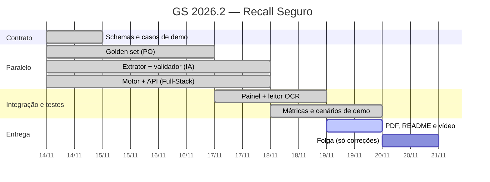

### 🎓 Integração de disciplinas

| Componente | Disciplina |
|---|---|
| Extração com schema e few-shot | IA Generativa · Engenharia de prompts |
| Leitura de lote e código de barras | Visão computacional |
| Motor de regras + pendências | Regras de negócio · Qualidade de dados |
| Golden set e métricas | Estatística · Avaliação de modelos |
| URL + hash, evidência, decisão humana | Governança · Rastreabilidade · LGPD |
| API e painel | Back-end Python · Front-end React |
| Coletor de alertas | Automação / RPA |

---

## 📁 Estrutura de pastas

```
GLOBAL_SOLUTION_2026_2/
├── README.md                     ← este arquivo (página inicial)
├── CLAUDE.md · assets/ · 1TIAO/  ← contexto do projeto e estrutura do template FIAP
└── 2TIAO/GLOBAL-SOLUTION-2/
    ├── README.md                     ← README do projeto (mesmo conteúdo, caminhos locais)
    ├── data/                         ← golden set, levantamento, textos oficiais, fotos de teste, imagens da demo
    ├── docs/
    │   ├── GS2026-2_Recall_Seguro.pdf     ← PDF único da entrega
    │   ├── arquitetura.md · evidencias_testes.md · revisao_entrega_checklist.md
    │   ├── resultados_extracao.md · resultados_ocr.md · ia_limites_e_riscos.md
    │   ├── img/                           ← diretório de referência das imagens (ver img/README.md)
    │   │   ├── capa/ · destaques/ · diagramas/ · graficos/ · telas/ · exemplos/
    │   │   └── fontes/                    ← scripts e HTML que geram as imagens
    │   └── pdf_fonte/                     ← HTML + script do PDF
    ├── notebooks/
    └── src/
        ├── ia/          ← extrator LLM, validador, leitor OCR, avaliação (194 testes)
        ├── backend/     ← FastAPI + motor de regras + testes
        ├── painel/      ← painel da rede (React + Vite)
        └── app-cidadao/ ← app do cidadão (em desenvolvimento)
```

---

## 🎓 Sobre o portfólio FIAP

> Este repositório segue o template oficial [FIAP-PORTFOLIO-AI](https://github.com/fiap-tutoria/FIAP-PORTFOLIO-AI). O projeto da Global Solution 2026.2 fica em [`2TIAO/GLOBAL-SOLUTION-2`](2TIAO/GLOBAL-SOLUTION-2/README.md); as demais pastas são a estrutura padrão do template.

### 👩🏻‍💻 Sobre este Repositório

Este repositório tem como objetivo centralizar **todos os trabalhos, projetos, desafios, sprints, entregas e experimentos desenvolvidos durante a Graduação ON em Inteligência Artificial da FIAP**.

Aqui está documentada minha evolução técnica, analítica e estratégica ao longo do curso, contemplando:

- Projetos acadêmicos (PBLs, Global Solutions, Challenges)
- Implementações práticas de IA e Machine Learning
- Modelagem de dados e engenharia de dados
- Experimentos com Deep Learning
- Aplicações com IA Generativa
- Integrações com IoT e sensores
- Documentações técnicas completas
- Arquiteturas de solução
- Estudos dirigidos e explorações técnicas
- ...

Este repositório funciona como um **portfólio técnico estruturado**, evidenciando domínio progressivo das competências exigidas na formação.

---

### 🎯 Objetivo

Organizar e versionar todo o fluxo de desenvolvimento acadêmico, garantindo:

- 📌 Organização e rastreabilidade das entregas
- 📌 Evolução contínua do conhecimento
- 📌 Documentação clara e técnica
- 📌 Reprodutibilidade dos experimentos
- 📌 Portfólio profissional estruturado

---

### 🧠 Estrutura Macro do Repositório

```bash
📂 FIAP-PORTFOLIO-AI
│
├── 📂 1TIAO
│   ├── 📂 ENTERPRISE-CHALLENGE
│   ├── 📂 FASE1
│   │   ├── 📂 CAP-X-NOME-DA-ATIVIDADE-APRESENTADA-NO-PORTAL
│   ├── 📂 FASE2
│   ├── 📂 FASE3
│   ├── 📂 ...
│   ├── 📂 GLOBAL-SOLUTION-1    
│   └── 📂 GLOBAL-SOLUTION-2
│
├── 📂 2TIAO
│   ├── 📂 ENTERPRISE-CHALLENGE
│   ├── 📂 FASE1
│   │   ├── 📂 CAP-X-NOME-DA-ATIVIDADE-APRESENTADA-NO-PORTAL
│   ├── 📂 FASE2
│   ├── 📂 FASE3
│   ├── 📂 ...
│   ├── 📂 GLOBAL-SOLUTION-1    
│   └── 📂 GLOBAL-SOLUTION-2
│
└── README.md
```

---

## 📋 Licença

<p xmlns:cc="http://creativecommons.org/ns#" xmlns:dct="http://purl.org/dc/terms/"><a property="dct:title" rel="cc:attributionURL" href="https://github.com/fiap-tutoria/FIAP-PORTFOLIO-AI">TEMPLATE - FIAP PORTFÓLIO AI</a> por <a rel="cc:attributionURL dct:creator" property="cc:attributionName" href="https://fiap.com.br">FIAP</a> está licenciado sobre <a href="http://creativecommons.org/licenses/by/4.0/?ref=chooser-v1" target="_blank" rel="license noopener noreferrer" style="display:inline-block;">Attribution 4.0 International</a>.</p>
